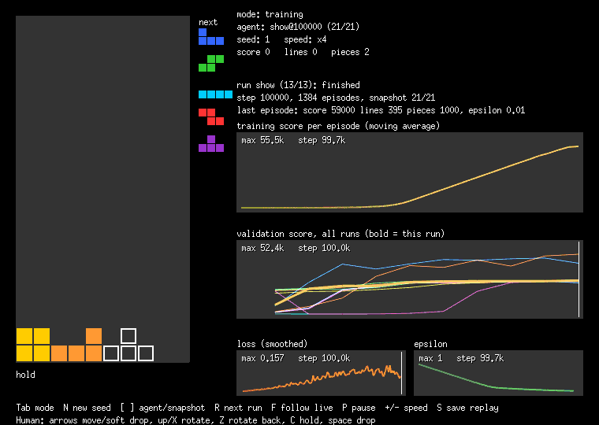
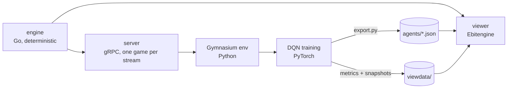

# Tetris ML

A Tetris engine written in Go, a reinforcement learning agent trained with PyTorch, and a viewer that shows the agent playing and learning. I built it to learn RL by doing every layer myself.



| Agent (seeds 1-100, 3000-piece cap) | Avg score | Avg lines |
|---|---|---|
| Random placement (1000-piece cap) | 2 | 0.0 |
| Hand-weighted heuristic | 119,880 | 1,098.8 |
| DQN (mean of 3 training seeds) | 172,673 | 1,179.8 |
| Double DQN (mean of 3 training seeds) | 173,305 | 1,179.4 |

The write-up, including what did not work, is in [docs/BLOG.md](docs/BLOG.md).

## How it fits together



- **Engine** (`engine/`): board, 7 tetrominoes, 7-bag, SRS rotation and kicks, gravity, lock, line clears. Seedable, so every game is reproducible. It has no rendering code.
- **Heuristic** (`heuristic/`): placement features (aggregate height, holes, bumpiness, lines) and a hand-weighted picker, used as the baseline.
- **Server** (`server/`, `proto/`): exposes the engine over gRPC. Each `Play` stream is one game and returns the valid placements together with the features of the board after each one.
- **Training** (`training/`): a Gymnasium environment on top of the server, a DQN that scores the board after each placement, and the logging the viewer reads.
- **Viewer** (`cmd/viewer`): a separate Ebitengine client for human play, agent playback, replays and watching training. It runs the exported networks itself and does not need the server.

Training never depends on rendering.

## Setup

Needs Go 1.25+ and Python 3.11. Tested on Windows 11 only.

```bash
go test ./...

cd training
python -m venv .venv
# use .venv/bin/pip on Linux and macOS; install the CPU build of PyTorch first (the network is tiny)
.venv/Scripts/pip install torch==2.14.1 --index-url https://download.pytorch.org/whl/cpu --extra-index-url https://pypi.org/simple
.venv/Scripts/pip install -r requirements.txt
python -m unittest
```

The generated gRPC code is committed. To regenerate it after editing `proto/tetris/v1/tetris.proto`, run `proto/generate.sh` (it needs `protoc-gen-go` and `protoc-gen-go-grpc`, see the script).

## Run it

Baselines, no Python needed:

```bash
go run ./cmd/baseline -games 100 -max-pieces 3000   # heuristic
go run ./cmd/headless -seed 1                       # one random game
```

Train an agent (the server must be running):

```bash
go run ./cmd/server                                 # terminal 1, listens on 127.0.0.1:50051

cd training                                         # terminal 2
python train.py --name mine --double                # writes ../viewdata/mine while it trains
python evaluate.py checkpoints/mine_best.pt --max-pieces 3000
tensorboard --logdir runs
```

Viewer:

```bash
go run ./cmd/viewer                                 # trained agents in agents/
go run ./cmd/viewer -mode human                     # play yourself
go run ./cmd/viewer -mode training -run mine        # watch a run, live or finished
```

Keys are listed in [docs/VIEWER.md](docs/VIEWER.md). Two trained agents are included in `agents/`. To show your own, run `python export.py mine` in `training/`.

## Docs

- [BLOG.md](docs/BLOG.md): the write-up
- [PLAN.md](docs/PLAN.md): the original plan
- [BASELINE.md](docs/BASELINE.md): heuristic baseline numbers
- [BRIDGE.md](docs/BRIDGE.md): the Go-Python bridge, how it was verified, throughput
- [DQN.md](docs/DQN.md) and [EXPERIMENTS.md](docs/EXPERIMENTS.md): training results
- [VIEWER.md](docs/VIEWER.md): viewer controls and limits

## Limits

- Actions are placements (a rotation and a column per piece), so the agent never tucks or spins. This keeps training fast but caps how good it can play.
- No hold piece, no lock delay, and gravity is one row per step in the environment.
- Results come from 3 training seeds per variant at most, and evaluation is capped at 3000 pieces, which hides differences between the strongest agents.
