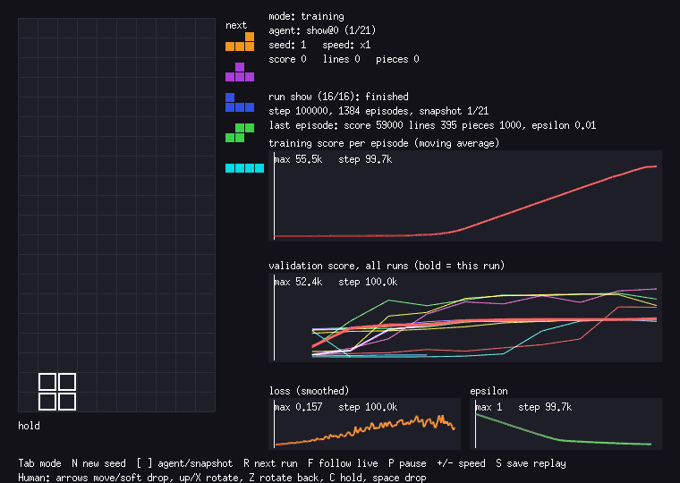
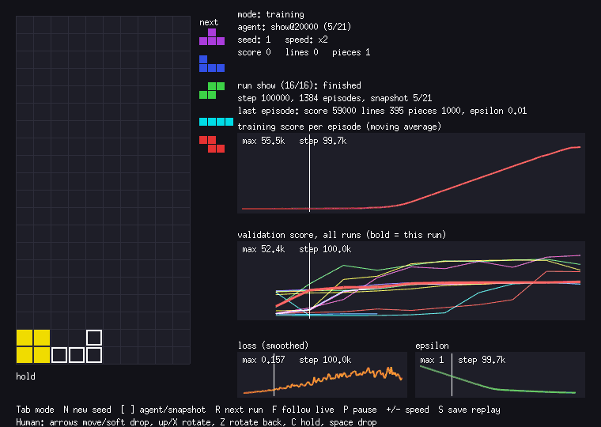

# Teaching a neural network to play Tetris, one layer at a time

*Draft for the portfolio. The code is at https://github.com/nweber23/tetri_ml.*

I wanted to learn reinforcement learning by building every layer myself: the game, the baseline to beat, the bridge to Python, the agent, and a way to watch it. This post walks through that in order and spends as much time on what did not work as on what did.

## Why Tetris, and why Go

Tetris is small enough to train on a laptop and still has the parts that make RL interesting: a long horizon (a bad placement hurts ten pieces later), a reward that is rare early on (you cannot clear a line by chance), and a state space too big to enumerate.

I wrote the game in Go because I wanted a fast, deterministic engine with no rendering in it, and did the learning in Python because PyTorch lives there. The rule I held myself to: training never depends on rendering.

## The engine

The engine has the board, the seven tetrominoes, a 7-bag randomizer, SRS rotation with wall kicks, gravity, locking, line clears and game over. Two decisions mattered later:

- **Everything is seeded.** One seed fixes the whole piece sequence, so any game can be replayed exactly and two agents can be compared on identical games. This paid off three times: in the baseline, in checking the Go-Python bridge, and in the viewer's replays.
- **Rows grow upward and four hidden rows sit above the visible 20.** Pieces spawn in the hidden rows; a game ends when a new piece overlaps the stack or a piece locks entirely above the field.

Gravity is simple on purpose: each `Step` applies one action and then one gravity tick, and a piece that cannot fall locks at once. There is no lock delay. That keeps the environment small, at the cost of realism. (The viewer needed gravity on a timer, so I later split `Step` into `Apply` and `Gravity` without changing `Step`.)

## A baseline before any learning

Before training anything I wanted a number to beat. The usual cheap trick is to stop thinking in moves and think in **placements**: for each piece, list every (rotation, column) it can be dropped at, look at the board that would result, and score it. The score is a weighted sum of four features: aggregate height, holes, bumpiness and lines cleared. I used a widely published set of weights (from Yiyuan Lee's Tetris AI write-up) and did not tune them.

On 100 seeded games, capped at 1000 pieces per game, that heuristic scored 42,591 on average and survived the cap in 96 of 100 games.

That last number was the first lesson. **A baseline that never loses cannot rank anything on survival.** Raising the cap to 10,000 pieces still left half the games capped. From here on I compared agents on score at a fixed cap and kept in mind that the cap hides differences.

## Bridging Go and Python

The engine runs as a gRPC server: one stream is one game. A Python Gymnasium environment talks to it, and vectorized environments run several games in parallel. On my machine, 4 environments reached about 5,200 steps per second and 8 reached about 7,100, where a step is one piece placement.

Checking that the bridge was right was harder than building it. The obvious test, "a random agent gets the same numbers on both sides", does not work: a random agent almost never clears a line in its first 20 pieces, so the scores are near zero and tell you nothing, and Go and Python use different random number generators anyway. So I wrote a deterministic agent whose choice depends only on the piece count, ran it on both sides over 200 seeds, and compared score, lines and pieces per game. All 200 matched. It does not test rewards (the Go unit tests do that), but it does prove both sides see the same game.

## The agent

The network does not output a value per action. It scores the **board after a placement** (the afterstate) from the same four features the heuristic uses, and the agent plays the placement with the highest score. The training target is the usual DQN one: the reward plus the discounted best value among the next piece's placements, from a slowly updated target network. A small MLP (4-64-64-1), a replay buffer, epsilon decay from 1 to 0.01 over 50,000 steps, 100,000 steps in total.

I ran two reward setups against each other. The raw one gives the line-clear score. The shaped one adds a penalty for holes and height as a potential-based term, which changes the learning signal without changing which policy is best.

*Left: the untrained network. Right: the same seed after 20,000 steps. The final network is the animation at the top.*

## What worked

On the baseline seeds, which the agent never trained on, with a 3000-piece cap:

| Agent | Avg score | Avg lines | Avg pieces |
|---|---|---|---|
| Random placement (1000-piece cap) | 2 | 0.0 | 22.0 |
| Heuristic | 119,880 | 1,098.8 | 2,764.2 |
| DQN, 3 training seeds (mean) | 172,673 | 1,179.8 | 2,962.2 |
| Double DQN, 3 training seeds (mean) | 173,305 | 1,179.4 | 2,961.1 |

The agent beats the heuristic it started from by about 44% on score. It plays about as many lines per game, because both are close to the cap, so the gain is in score: my guess, which I did not test, is that it clears lines in bigger groups, which the score rewards and the heuristic's weights do not know about.

The formulation did most of the work. Scoring afterstates and acting on placements shrinks the problem so much that the raw-reward agent was already reaching the 500-piece validation cap after 10,000 steps.

## What did not work, or did not matter

- **The shaped reward did not help, and it got worse before it got better.** In its single run the validation score was at or near zero from 20,000 to 40,000 steps and recovered only after epsilon reached its floor at 50,000. The final score was within noise of the raw run. I have a guess about why (the hole penalty rewarding safe-looking placements while the value estimates are still wrong) but I did not test it.
- **Double DQN made no measurable difference.** Over three seeds each, it was 0.4% ahead on score, against a spread of about 1.4% between seeds of the same variant. A likely reason, also untested: the value depends on only four features, so there is little overestimation to correct. I skipped dueling heads because the network has no per-action outputs to split.
- **The measurement was the real problem.** At a 1000-piece cap every agent looked the same, so I moved to 3000. The strongest agents still sit within a few percent of each other, and three seeds cannot rank them. I would need a different measure, such as score per piece or a much higher cap, before claiming anything finer.
- **Things I did not try:** PPO, a CNN on the raw board, and a human-versus-agent mode.

## Watching it learn

A plain learning curve says little, so I built a viewer (Ebitengine) with a training mode. The training process writes a metrics log and a snapshot of the network every 5,000 steps, and the viewer replays the same seed with each snapshot, next to the score, loss and epsilon charts. Because it just reads files, the same view works on a run that is still going. There is also a heatmap of the agent's value for every candidate placement, which makes it easy to see when the agent is sure and when it is choosing between near-equal moves.

## Limits worth stating

- Actions are placements, so the agent never tucks or spins. It trains fast and plays within a ceiling.
- No hold piece, no lock delay.
- At most three training seeds per variant, one for the shaped reward.
- Tested on Windows 11 only.

## What I would do next

Evaluate on a harder measure than score at a cap, try PPO as a genuinely different algorithm instead of another variation on DQN, and add tucks and spins to the action space to see how much the placement shortcut costs.

The code, the plan I followed and all the run notes are in the repository.
