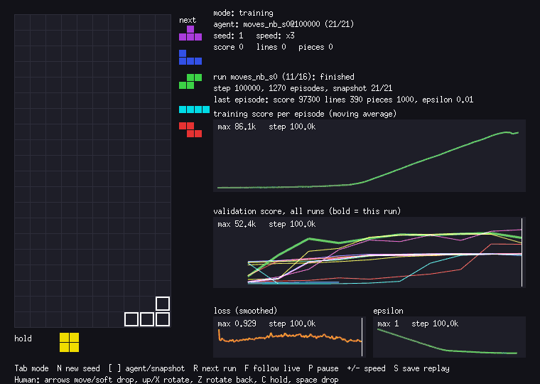

# Phase 8: an agent that uses the whole game (hold, tucks, spins, T-spins)

The placement agents only choose a column and rotation for a straight drop. This phase gives the agent every way a player can lock a piece. Status: **a learned agent now works, but only when the network cannot see the board.** The runs that failed are kept below so nobody repeats them.



## What was built

- `engine.Moves()` (`engine/moves.go`): a BFS over keys (left, right, rotate both ways, soft drop) from the spawn position. Every grounded position it reaches is a candidate, deduplicated by the cells it fills and by whether it is a T-spin. With hold available it also searches from the piece a hold would bring in. Each `Move` carries its key sequence, the board after locking, lines cleared and reward. `Game.Do(move)` plays it.
- No gravity and no lock delay inside the search: the piece can be steered at will, as in high-level play. About 43 candidate moves per state on average, 70 at most in play; the server caps the list at 128 (`server.MaxMoves`).
- T-spin: the three-corner rule, only when the last key was a rotation. Scores 400/800/1200/1600 for 0/1/2/3 lines. No mini T-spins. A zero-line T-spin is worth 400, which is a lot (a double is 300).
- `PlayMoves` RPC and the `Tetris-v1` env (`training/tetris_env/env.py`, `MoveEnv`): the action is an index into the listed moves (see [BRIDGE.md](BRIDGE.md)).
- Network input (`agent.MoveFeatures`, 218 bytes, one source for Go and Python): aggregate height, holes, bumpiness, lines; the 20 visible rows as 0/1; one-hot of the held piece after the move; one-hot of the next piece (zero if unknown after a hold from an empty slot).
- `training/dqn_moves.py`, `train_moves.py`, `export_moves.py`: U(afterstate) excludes the move's own reward; a move is worth `reward/100 + 0.99 * U`; the TD target is the best such value over the next state's moves, or `-death_penalty` for a finished game.
- Viewer: move agents are steered key by key, so slides, spins and holds are visible. `go run ./cmd/baseline -agent <agent>` reports T-spins and holds per game for any move agent, exported or scripted.

## Results

Seeds 1-100, 3000-piece cap, greedy play. These seeds were never trained on. Move-agent scores include T-spin points, so they are not directly comparable with the placement scores; compare lines per piece and score per piece with that in mind.

| Agent | Avg score | Avg lines | Avg pieces | Hit cap | Score / piece | T-spins / game | Holds / game |
|---|---|---|---|---|---|---|---|
| Placement heuristic | 119,880 | 1,098.8 | 2,764 | 83/100 | 43.4 | | |
| Placement DQN (`raw`) | 173,983 | 1,173.3 | 2,948 | 96/100 | 59.0 | | |
| Scripted `heuristic-moves` | 164,331 | 1,198.5 | 3,000 | 100/100 | 54.8 | 70.2 | 874.3 |
| Learned move agent, seed 0, final (100k) | 241,493 | 984.9 | 2,481 | 66/100 | 97.4 | 233.4 | 730.4 |
| Learned move agent, seed 0, best validation (90k) | 206,816 | 812.6 | 2,057 | 42/100 | 100.5 | 222.8 | 795.9 |
| Learned move agent, seed 1 (best = final, 100k) | 236,973 | 912.9 | 2,308 | 54/100 | 102.7 | 253.9 | 931.6 |

What this shows and what it does not:

- **Both learned agents score more than the scripted agent that already uses everything** (241k and 237k against 164k), with about 100 points per piece against 55. They do it with T-spins: 233 and 254 per game, against 70. At 400 points or more each, that is at least 93,000 points of the 241,000 for seed 0. I did not split the score further.
- **They are less robust.** The scripted agent reached the cap in every game; the learned ones in 66 and 54 of 100. Their worst games ended after 70 and 137 pieces. Their line rate is the same as everyone else's (0.40 lines per piece for all three), so they are not clearing more lines, they are scoring more per line cleared and dying more often.
- **Clear sizes shifted too** (`go run ./cmd/baseline -agent agents/moves_nb_s0_final.json`): doubles are 48% of cleared lines for seed 0 (single 34%, triple 13%, tetris 4.5%), against 90% singles for the scripted agent.
- **Two training seeds, both learned.** Seed 0 was at 496 of 500 pieces in validation by 30k steps and seed 1 at 498.5 by 70k, so the speed varies. I have no third seed.
- **Picking the "best" checkpoint on 10 validation games was noisy.** For seed 0 the checkpoint chosen at 90k scored 206,816 on seeds 1-100 and the final one 241,493. Treat the best-validation rows as a warning about the selection, not as a fair second result.
- **The agent cannot see the board**, only height, holes, bumpiness, lines, the held piece and the next piece after each candidate move. It finds T-spins because the move list already contains them with their 400+ reward; the network never has to spot a T-slot, it only has to keep the stack in a shape where such moves appear. This is my reading, I did not test it.

## Training runs

Validation is 10 greedy games on seeds 5001-5010, 500-piece cap, every 10k steps. A game that ends after about 22 pieces is no better than random play (random play lasts about 25 pieces). For comparison, the placement DQN was already at the 500-piece cap at 10k steps. Columns: score / lines / pieces / T-spins / holds per game.

| Run | Setup | 10k | 20k | 30k |
|---|---|---|---|---|
| `moves_s0` | random init, no death penalty, lr 1e-3, board visible; stopped at ~35k | 440 / 0 / 19.9 / 1.1 / 4.0 | 160 / 0.4 / 23.8 / 0.3 / 8.3 | 630 / 0.3 / 23.3 / 1.5 / 8.8 |
| `moves_warm_s0` (first) | heuristic warm start, no death penalty; stopped at 20k | 160 / 0 / 13.4 / 0.4 / 5.1 | 120 / 0 / 16.7 / 0.3 / 5.1 | |
| `moves_warm_s0` (second) | heuristic warm start + death penalty 5; stopped at 20k | 920 / 0 / 22.5 / 2.3 / 6.1 | 490 / 0.1 / 21.5 / 1.2 / 7.1 | |
| `moves_cold_s0` | random init + death penalty 5; stopped at 20k | 1050 / 0.1 / 22.8 / 2.6 / 8.0 | 520 / 0 / 23.5 / 1.3 / 6.9 | |
| `moves_lowlr_s0` | warm + penalty 5, lr 1e-4, board visible; stopped at 10k | 1700 / 0.6 / 29.8 / 4.1 / 9.3 | | |
| `moves_bait_s0` | warm + penalty 5, zero-line T-spins paid nothing in training, board visible; stopped at 20k | 80 / 0 / 15.2 / 0.2 / 4.8 | 0 / 0 / 13.8 / 0 / 4.9 | |
| **`moves_nb_s0`** | warm + penalty 5, **board hidden** (`--no-board`) | 7,120 / 24.0 / 95.7 / 10.9 / 29.1 | 27,610 / 120.2 / 344.1 / 35.5 / 147.7 | 43,680 / 189.4 / 496.0 / 54.3 / 217.1 |
| **`moves_nb_s1`** | same, seed 1 | 2,050 / 3.3 / 34.2 / 4.3 / 10.0 | 6,570 / 19.8 / 88.4 / 10.7 / 32.3 | 13,960 / 60.5 / 192.9 / 18.2 / 70.6 |

`moves_nb_s0` went on to 47,700 at 60k, 49,020 at 90k and 44,500 at 100k; `moves_nb_s1` reached 52,370 at 100k with all 500 pieces survived.

Controls that rule out a pipeline bug:

- A hand-built linear net with the heuristic weights, run through the Python env and `best_move`: 5 games, 500-piece cap, 33,400 score, 197.4 lines, all 500 pieces survived, 28.4 T-spins.
- The warm-started network before any training, same path: 300-piece cap, 20,080 score, 118.8 lines, 300 pieces, 17.2 T-spins, 87.6 holds.
- The exported agents reproduce PyTorch's outputs in Go (`go test ./agent`).

## What the experiments say about why training failed

Training degraded a network that started out playing well, in every run where the 200 board cells were an input. The hypotheses, with what was found:

1. **Board input.** Hiding the board is the only change that made training work (`moves_nb_*`), on two seeds. That supports "the raw board is the problem", but I did not isolate why. "The 200 inputs add noise that swamps small differences between candidates" is one reading; too much capacity or a learning rate that is wrong for those inputs are others. A lower learning rate with the board visible (`moves_lowlr_s0`) was stopped after one check (29.8 pieces at 10k, no real learning), which is not conclusive.
2. **Zero-line T-spin bait: rejected as the cause.** Paying nothing for them in training (`moves_bait_s0`, board visible) still failed, and worse (13.8 pieces at 20k, no T-spins at all). The board-hidden agents learn with the 400 points on offer.
3. **Value scale and the game-over target.** A finished game used to bootstrap to exactly 0, which beats the negative values of a warm-started net; the death penalty of 5 is in every run since the second warm start and did not fix the board-visible runs. `train_moves.py` now logs the mean, min and max of the learned values to TensorBoard (`train/value_*`); I did not look at them.
4. **Update dynamics** (128-candidate max over a bootstrapped target, target sync every 1000 steps): not investigated. The placement DQN used the same scheme and worked on 4 features.

Do not redo: cold vs warm, with/without the death penalty at lr 1e-3 with the board visible (all failed the same way), nor the bait test above.

## How the training code works

- `MoveNet` (`dqn_moves.py`): MLP 218 -> 128 -> 64 -> 1, input divided by `SCALE` (first four features scaled, the rest 0/1). `warm_start=True` makes units 0-3 of both hidden layers pass the four scaled heuristic features through and sets the output weights to the heuristic weights times 0.1 (all other output weights 0), so it starts as the heuristic. `use_board=False` multiplies the 200 board inputs by 0 (the `visible` buffer); `agent_doc` zeroes those first-layer weights on export so the Go side stays a plain MLP. **Export runs trained with `--no-board` with `export_moves.py --no-board`**, otherwise the board weights, which never trained, are exported as they were initialised.
- U excludes the move's own reward. Move value = `reward/100 + 0.99 * U(afterstate)`, in Go (`agent.BestMove`) and in Python. Truncation at `--max-pieces` is not a terminal.
- `Replay` stores the 200 board cells bit-packed (43 bytes per candidate) so 50k transitions x 128 candidates fit in about 300 MB.
- Speed: about 25-40 environment steps/s with one run alone (100k steps take 40-60 minutes), slower when runs share the machine.
- Seeds: training games 1,000,000+; validation 5001-5010; final comparison seeds 1-100. Same as the placement agents.
- Flags: `--cold`, `--no-board`, `--zero-tspin-bait`, `--death-penalty`, `--lr`, `--update-every`, `--steps`, `--name`, `--seed`. Checkpoints `training/checkpoints/<name>_best.pt` (best validation) and `<name>.pt`; TensorBoard in `training/runs/<name>`; viewer data in `viewdata/<name>/`. All git-ignored.

```
go run ./cmd/server
cd training
python train_moves.py --name moves_nb_s0 --no-board
python export_moves.py moves_nb_s0 --no-board --final     # writes ../agents/moves_nb_s0_final.json
cd .. && go run ./cmd/baseline -agent agents/moves_nb_s0_final.json -games 100 -max-pieces 3000
go run ./cmd/viewer -mode training -run moves_nb_s0
```

## Limits and what is still open

- The search assumes the piece can be steered at will: no gravity, no lock delay. Real play with a 500 ms gravity could not do every listed move.
- T-spin = three-corner rule only; no mini, no wall-kick special case. A zero-line T-spin scores 400. No combos, no back-to-back.
- `server.MaxMoves = 128` silently truncates (never reached in play; 70 was the most seen).
- `engine.Step(SoftDrop)` moves one row and does not apply gravity on top; `Step` never locks on a soft drop.
- After a hold from an empty slot the "next piece" feature is zero (unknown); this is intentional.
- Viewer replays store placements, so move-agent games and human games cannot be saved.
- The agent sees one next piece even though the engine and viewer now queue five.
- Open: an agent that sees the board and still learns (small learning rate only on the board weights, or compact slot features such as column heights and wells instead of 200 raw cells); more than two seeds; a longer cap or a survival-focused measure, since 34-46% of the learned games end before 3000 pieces; whether a death penalty larger than 5 improves robustness.
